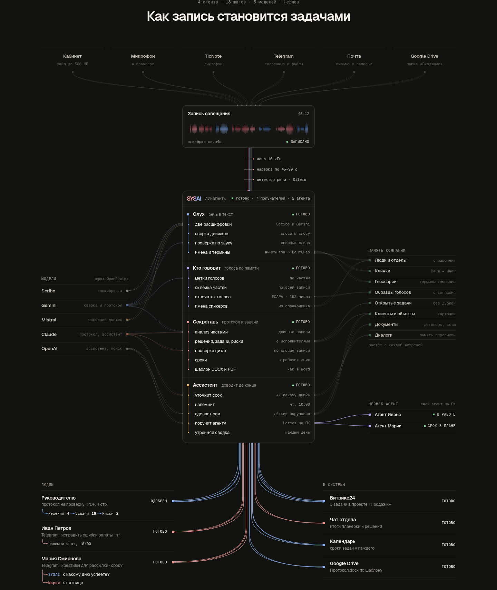

# Лендинг: схема «Как запись становится задачами»

Стартовая страница sysai.onrender.com (`/`, шаблон `app/templates/landing.html`). Под логотипом — живая запись
совещания двух голосов, ниже — схема: как одна запись проходит через 4 ИИ-агента и 18 шагов и становится протоколом,
задачами и сроками у людей и в системах. Версия 4, задача №31 в [плане](PLAN.md).



- Видео, 26 секунд, 1440×900: [media/landing-scheme.mp4](media/landing-scheme.mp4) — прокрутка от первого экрана
  через всю схему, шаги загораются по очереди.
- Телефон, 390 px: [media/landing-scheme-mobile.png](media/landing-scheme-mobile.png) — всё на одной вертикальной линии.

## Что на схеме

Сверху вниз:

1. **Источники (6):** Кабинет (файл до 500 МБ), Микрофон в браузере, TicNote, Telegram (голосовые и файлы), Почта
   (письмо с записью), Google Drive (папка «Входящие»). Из каждого — пучок тонких линий в «Запись совещания».
2. **Запись совещания** — пиксельная звуковая волна двух голосов (коралловый — директор, синий — Иван).
3. **Подготовка звука:** моно 16 кГц, нарезка по 45–90 с, детектор речи Silero.
4. **ИИ-агенты** — 4 агента и 18 реальных шагов из кода:
   - **Слух** (речь в текст): две расшифровки (Scribe и Gemini), сверка движков слово к слову, проверка спорных
     слов по звуку, имена и термины компании («винсунаба → ВентСнаб»);
   - **Кто говорит** (голоса по памяти): метки голосов по частям, склейка частей по всей записи, отпечаток голоса
     (ECAPA, 192 числа), имена спикеров из справочника;
   - **Секретарь** (протокол и задачи): анализ длинной записи частями, решения, задачи и риски с исполнителями,
     проверка цитат по словам записи, сроки в рабочих днях, документ по шаблону DOCX и PDF;
   - **Ассистент** (доводит до конца): уточнит срок, напомнит, сделает лёгкое поручение сам, поручит агенту Hermes на
     ПК сотрудника, утренняя сводка.
5. **Слева — модели через OpenRouter:** Scribe, Gemini, Mistral, Claude, OpenAI. От каждой — линии к шагам, где она
   работает.
6. **Справа — память компании** (люди и отделы, клички, глоссарий, образцы голосов с согласия, открытые задачи,
   клиенты и объекты, документы, диалоги) и **Hermes Agent** — свой агент на ПК Ивана и Марии.
7. **Снизу — «Людям»** (руководитель получает протокол на проверку, Иван — задачу и напоминание, Мария — вопрос о
   сроке) и **«В системы»** (Битрикс24, чат отдела, календарь, Google Drive).

## Как работает анимация

Код — `app/static/landing.js` (без библиотек), стили — `app/static/landing.css`.

- **Линии строятся по настоящим блокам.** Связи задаются атрибутами в разметке, и при изменении текста линии
  перестраиваются сами:
  - `data-uses="gemini claude"` у шага — какие модели он использует (линии от моделей слева);
  - `data-mem="tasks clients"` у шага — что он читает из памяти компании (линии справа);
  - `data-from="tasks dates ask"` у получателя внизу — от каких шагов к нему идут линии;
  - `data-k` — ключ строки, `data-a` — ключ агента, `data-m` — ключ модели, `data-tone` — цвет ветки.
- **Прокрутка рисует линии:** фронт идёт чуть выше низа экрана, линии растут за ним и не убираются обратно.
- **История по часам анимации** (массив `STEPS`, круг 22,4 с): запись → подготовка звука → Слух → Кто говорит →
  Секретарь → протокол руководителю → одобрен → задачи людям и в системы → задача агенту Ивана → Мария называет срок →
  срок в Битрикс24 → «готово · 7 получателей · 2 агента». Полная картина держится около 4 секунд, потом всё
  повторяется. Когда схема не видна или вкладка скрыта, часы стоят.
- **Сигнал** — короткая пиксельная звуковая волна, бегущая по линии; линия за ним окрашивается.
- **Наведение мышью** на строку показывает, куда идут её линии.
- **«Уменьшить движение»** в системе (`prefers-reduced-motion`) — сразу конечная картина, без анимации.
- **Узкий экран (< 1120 px)** — одна колонка: источники в три ряда, запись, подготовка звука, агенты (модели —
  строкой меток над ними), потом память компании, Hermes и получатели на одной вертикальной линии слева.

## Как снять скриншоты и видео

Нужны Node, Playwright и запущенное приложение (по умолчанию `http://127.0.0.1:8765/`, другой адрес — в переменной `U`):

```bash
uvicorn app.main:app --host 127.0.0.1 --port 8765 &
# конечная картина схемы (анимация выключена): ширина, высота окна, блок, файл, ждать мс, плотность пикселей
node scripts/landing_shot.js 1440 1800 '#how' docs/media/landing-scheme-desktop.png 1500 1
node scripts/landing_shot.js 390 5000 '#how' docs/media/landing-scheme-mobile.png 1500 2
# видео: w:МС — ждать, s:Y — прыжок, sm:Y:МС — плавная прокрутка к Y (или к #блоку) за МС
node scripts/landing_video.js 1440 900 docs/media/landing-scheme.mp4 \
  "w:1000 sm:1150:1800 w:1600 sm:1600:1200 w:2400 sm:1950:1200 w:1800 sm:2200:1200 w:8000"
```

Chromium берётся тот, что ставит Playwright (`npx playwright install chromium`), или путь из переменной `CHROMIUM`.
Для видео нужен ffmpeg.
